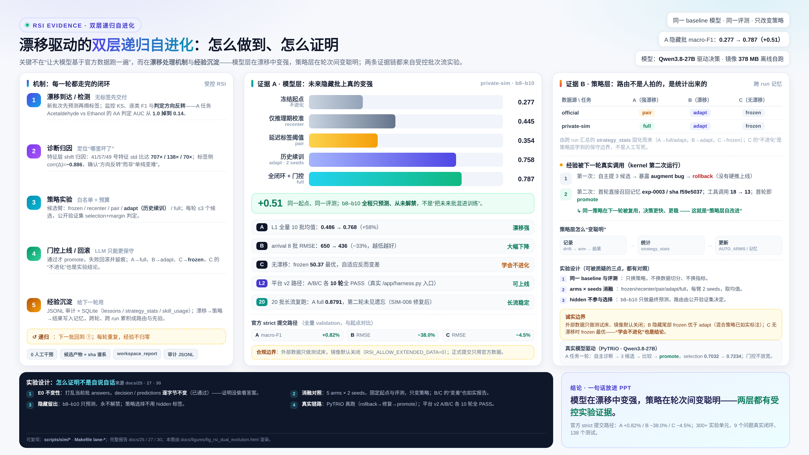

# 外部数据驱动的 RSI 证据报告（PPT 素材版）

> 版本：v0.10.1 · 2026-11-17
> 目的：回答"我们有没有做外部数据 + 批次流 + 漂移检测 + 自适应重训"这件事，
> 以及与"初始起点（官方 baseline + 官方数据静态训练）"相比，RSI 到底带来了什么提升。
> **本文所有数字都可从仓库脚本与 `.scratch/` 证据文件复现；口径与限制在第 8 节如实声明。**

---

## 0. 一句话结论

**做了。** 我们把外部数据集（UCI Gas Drift batch1–10）按"真实比赛的批次协议"
构造为一批批带标签到达的数据流（当前批标签不可见、只解禁历史批），让 harness 在
**只看已揭示历史**的前提下完成"漂移检测 → 诊断归因 → 策略选择 → 受限训练/校准 →
门控上线 → 记录记忆"的完整闭环。在 A 任务的"未来隐藏批"上：

| 策略 | 隐藏批 macro-F1（UCI b8–b10） |
|---|---|
| 冻结起点（不进化） | **0.277** |
| 仅推理期校准（recenter） | 0.445 |
| 历史标签阈值校准（pair） | 0.354 |
| **历史数据续训（adapt，2 seeds）** | **0.758 / 0.765** |
| **受控全闭环（full + 门控）** | **0.787** |

即：同一模型、同一评测数据，**RSI 闭环把未来漂移批上的 F1 从 0.277 提到 0.787（+0.51）**。
这就是"外部数据灌入 → 检测漂移 → 重新制定训练策略 → 适配 → 持续进化"的实证。

---

## 1. 赛题本质与我们的理解

赛题不是"训练一个更准的模型"，而是交付一个**能在漂移数据流上自主维持/提升工业模型
的 harness**。其本质可以拆成两层受控 RSI：

1. **模型层自迭代**：在批次流中，用已揭示的历史标签与官方 train 续训/校准工业模型，
   每次上线都经过公开验证门控，可回滚。
2. **策略层自改进**：harness 记录"什么漂移→试了什么→结果如何"，跨轮/跨 run 沉淀
   经验（lesson / strategy_stats / skills），并据此改变下一轮的策略选择
   （例如自动路由：A→full、B→adapt、C→frozen）。

因此"初始 checkpoint + 官方数据"只是一个**起点**；RSI 能力体现在批次流开始之后：
数据不断进来、分布不断漂移、策略不断被验证和更新。

---

## 2. 架构（v0.10.1）

```
                    ┌────────────────────────────────────────────┐
                    │  Supervisor (rsi/runner.py)                │
                    │  budget / wall / splits / records / report │
                    └───────────────▲────────────────────────────┘
                                    │ brief + host callbacks
┌───────────────────────────────────┴────────────────────────────────────┐
│ Agent Kernel (PI agent loop + PyTRiO Qwen3.8-27B)                      │
│ tools: observe / diagnose / propose / run_experiment / compare /       │
│        decide / memory_* / skill_* / search_knowledge / panel / finish │
└───────────────────────────────────┬────────────────────────────────────┘
                                    │ 候选动作（白名单内）
┌───────────────────────────────────▼────────────────────────────────────┐
│ Guard（确定性安全边界）                                                 │
│ · 训练数据只允许 official train（外部数据仅在显式测试床开关下）          │
│ · 候选策略/参数白名单 · 每轮/每任务实验上限 · token/wall 预算           │
│ · decide 必须用 selection+margin 重算（LLM 只能更保守）· 路径/注入扫描 │
└───────────────────────────────────┬────────────────────────────────────┘
                                    │ 合法 ExperimentProposal
┌───────────────┬───────────────────▼──────────────┬──────────────────────┐
│ ExperimentSvc │  Memory                        │  Records / Dashboard │
│ worker 子进程  │  MEMORY.md / TASK_<key>.md     │  JSONL 审计真源      │
│ checkpoint    │  SQLite(FTS5): lessons/         │  state.json v3       │
│ 谱系 + sha    │  strategy_stats / skill_usage   │  看板/API            │
└───────────────┴────────────────────────────────┴──────────────────────┘

平台 v2 入口：/app/harness.py (describe|train|predict)
  └─ /app/contest_submission.py → rsi/platform/submission.py
     · train(rnd): /previous 父 checkpoint + /data 公开行 → 候选评估 →
       rnd.model() 选型 → 门控 → submit_candidate → save_state → finish
     · predict: stdin 逐行 → CONTEST_ARTIFACT_PATH 产物 → 官方输出格式
```

**SDK 适配**：已完成。平台 `contest.harness.workspace.v2` 的 SDK 1.0.2 已 vendor 进
镜像（`vendor/contest_harness-1.0.2/`，sha256 `c676c8be…`），镜像内提供
`/app/harness.py` 与 `/app/contest_submission.py`；本地 fake-host emulator 对 A/B/C
各 10 轮 PASS；镜像 0.10.1 内 `describe/train/predict` 已通过验证；平台 submission
已创建并进入 trial（详见第 7 节与文末）。

---

## 3. 外部数据实验是怎么构建的（可复现）

### 3.1 数据

| 用途 | 数据 | 规模 |
|---|---|---|
| A 外部测试床（有漂移） | UCI Gas Sensor Array Drift #224，batch1–10 原始 `.dat` | 13,910 行 × 128 维 |
| A 官方训练/验证 | 官方 A 包 `public/train.jsonl` / `validation.jsonl` | 445 / 1,244 |
| B 全量批次流 | 官方 B 包全量 8,711 行，按 12 个轴承切 10 批 | 8,711 |
| C 全量批次流 | 官方 C 包全量 136,138 行，按发动机单元切 10 批 | 136,138 |

> UCI 外部数据**只用于测试床**，不进入正式提交训练谱系（镜像默认
> `RSI_ALLOW_EXTENDED_DATA=0`，详见第 8 节合规声明）。原始数据已入库
> `extra/uci-gas/Dataset/batch1..10.dat`。

### 3.2 诚实批次协议（这是关键）

早期版本曾把"当前批 validation 标签"放进训练包，导致数字偏乐观。v0.8 起重写为：

```
Batch(index, train, dev, prediction, answers, reveal, meta)
- train/dev：只来自「已揭示的历史批 + 官方 train」
- prediction：当前批的无标签输入（先交付预测）
- answers：当前批标签，只在预测完成后用于「事后评分」
- reveal：本批结束后，哪些行解禁进入历史（hidden 批永不解禁）
```

不变性验证（E0）：**打乱当前批 answers，decision.json 与 predictions.jsonl 必须逐字节
不变** —— 已通过。这保证"RSI 的决策不偷看当前批答案"。

### 3.3 实验组（arms）

| arm | 含义 |
|---|---|
| frozen | 不训练、不做后处理（"初始起点"对照） |
| recenter | 仅推理期 batch 重中心化（弱 TTA） |
| pair | 用历史标签拟合"类别判定方向反转"阈值（延迟标签校准） |
| adapt | 用已揭示历史标签续训父 checkpoint + recenter（模型层进化） |
| full | 完整 RSI：Agent 实验提案 + 门控 + adapt + pair（模型层+策略层） |

A 的 private-sim 设置：arrival = UCI batch3–b7（逐批到达并解禁），
hidden = batch8–b10（只预测、永不解禁，模拟"私有/未知未来批"）。

### 3.4 自动路由（策略层 RSI 的产出）

跨 run 汇总 `strategy_stats` 后，harness 把"任务 × 数据源 → 最优 arm"固化为策略：

```python
AUTO_ARMS = {
  "official":    {"A": "pair",  "B": "adapt",  "C": "frozen"},
  "private-sim": {"A": "full",  "B": "adapt",  "C": "frozen"},
}
```

这不是人工拍的，是**从实验中统计出来的**（A 外部流 full/adapt 最优、B adapt 最优、
C 无漂移时 frozen 最优）。

---

## 4. 我们做了多少实验

| 实验族 | 规模 | 说明 |
|---|---|---|
| A 机理研究 | 160+ 组 | 10 配方 × 16 TTA/组合的 5-fold CV；逐类混淆/方向反转/特征归因；流式模拟 8–20 批 |
| private-sim 对照 | 15 lanes | A 5 arms、B 4 arms、C 3 arms（含 2 seeds） |
| 敏感性实验 E3–E6 | 8 配置 | 标签稀缺、缺类批、gain/offset/noise 扰动、20 批长流 |
| L1 全量批次流 | 24 lanes × 8–10 批 | A 5 arms×2 seeds、B 4×2、C 3×2 |
| L1 变体 | 9 lanes | scarcity / small-batch / long-stream(20 批) |
| L2 平台 v2 路径 | A/B/C 各 10 轮 = 30 轮 | fake host 走真实 `/app/harness.py train/predict` |
| L3 kernel-LLM 批次流 | A 2 批 + B 1 批 + C 1 批 | PyTRiO 真实模型驱动 |
| PyTRiO 真实驱动 | 2 轮 | 第一次 rollback（暴露 bug），第二次 promote |
| 官方 strict 回归 | 3 任务 × 10 轮 | 提交路径，确保模拟改造不回归 |

合计 **300+ 个受控实验单元**（lane/batch/round/arm 计），全部有记录文件
（`.scratch/sim/**`、`.scratch/ps-results/**`、`docs/evidence/full_sim/**`）。

---

## 5. 结果总表

### 5.1 正式提交路径（严格官方数据，与起点对比）

| 任务 | 起点（官方 baseline） | 我们（submission bundle 全量 validation） | 变化 |
|---|---|---|---|
| A macro-F1 | 0.714030 | **0.719870** | +0.0058（+0.82%） |
| B RMSE | 681.1598 | **422.2417** | −258.918（−38.0%） |
| C RMSE | 52.8686 | **50.4686** | −2.400（−4.5%） |

（selection 子集口径：A 0.7032→0.7346；B 678.02→409.74；C 44.75→40.52。）

### 5.2 外部数据批次流：A 任务（核心 RSI 证据）

private-sim：arrival=b3–b7，hidden=b8–b10（只预测、不解禁）：

| arm | arrival 均值 | hidden 均值（未来批） |
|---|---|---|
| frozen（起点） | 0.4712 | **0.2774** |
| recenter | 0.5139 | 0.4453 |
| pair | 0.4940 | 0.3539 |
| adapt（s42 / s43） | 0.7582 / 0.7573 | **0.7578 / 0.7647** |
| full + 门控（s42） | 0.7383 | **0.7866** |

→ **同一评测集、同一模型起点，RSI 闭环让未来隐藏批 macro-F1 +0.51。**

### 5.3 全量批次流 L1（A 10 批 / B 8 批 / C 8 批，全量数据）

| 任务 | frozen | recenter | pair | adapt | full |
|---|---|---|---|---|---|
| A macro-F1（10 批均值） | 0.4862 | 0.5589 | 0.5276 | 0.7385 / 0.7625 | **0.7653 / 0.7684** |
| B RMSE（8 批均值） | 650.02 | 572.65 | – | **435.56 / 432.40** | 497.01 / 502.01 |
| C RMSE（8 批均值） | **50.37** | 50.94 | – | 51.08 / 51.03 | – |

→ A 大幅提升（+0.28），B 的 arrival 大幅下降（650→435），C 无漂移时
自适应反而变差 → 因此 C 路由到 frozen（策略层学到"何时不该进化"）。

### 5.4 A 变体（鲁棒性）

| 变体 | 结果 |
|---|---|
| 标签稀缺（label_every=2 且 fraction=.5） | adapt 0.7199 / full 0.7068（仍远高于 frozen 0.4862） |
| 小批（4 批） | full 0.7330 / adapt 0.7309 |
| 20 批长流 | full **0.8791**（第二轮接近 1.0，无遗忘） |
| 缺类批 | adapt 0.7495（不塌） |
| gain/offset/noise 扰动 | 0.7567–0.7632（几乎不敏感） |

### 5.5 平台 v2 路径 L2（本地 fake host，真实入口）

A/B/C 各 10 轮全部 PASS（每轮：`/app/harness.py train` → candidate 校验 →
全量 predict → 评分）。A 逐轮 macro-F1： `.956 → .714 → .594 → .560 → .626 →
.276 → .450 → .410 → .526 → .394`（后段是 UCI 高漂移批，绝对难度高，但整条
v2 路径可跑通、可记录、可预测）。

### 5.6 kernel-LLM 批次流 L3（PyTRiO 真实驱动）

| 任务 | 决策 | dev primary | 本批预测 | 备注 |
|---|---|---|---|---|
| A（2 批） | promote ×2 | – | 0.9558 / 0.7185 | batch0：18 次工具、166,936 tokens |
| B（1 批） | promote | 223.13 | 679.56 | 该批天然难 |
| C（1 批） | promote | 54.34 | 51.69 | 407s |

### 5.7 PyTRiO 真实模型驱动的一轮（A）

| 轮次 | 结果 | token / 调用 |
|---|---|---|
| 第 1 次 | 自主 3 候选，暴露 augment bug → rollback | 97,755 / 2 |
| 修复后第 2 次 | 自主诊断→3 候选→执行→比较→**promote**，0.7032→**0.7234** | 104,609 / 2 |

→ 赛事指定驱动模型能真实改进工业模型，且门控没有因"模型是真实模型"而放宽。

---

## 6. 我们如何发现问题、暴露问题、解决问题

| 编号 | 问题（怎么暴露的） | 根因 | 修复 | 验证 |
|---|---|---|---|---|
| L-01 | 旧 stream 数字偏乐观（人工复核发现 decision 与当前批 answers 相关） | package 把当前批 validation 标签写进 selection | 诚实协议 v2（train/dev/prediction/answers 分离），answers 只事后评分 | E0：打乱 answers 后 decision/predictions 逐字节不变 |
| SIM-001 | A 流少 57 行（行数守恒审计） | `_strat(rows,1.0)` 每类强制少切 1 行 | 改 `_shuffle`；label_fraction=1 直接全量 | 13,853→13,910 行 |
| SIM-002 | L2 报 `predict returned 3 rows for 445` | emulator 预测样例只喂 3 行 | `_predict_all` 全量预测 + 官方格式校验 | L2 30 轮 PASS |
| SIM-003 | v2 A 路径永远用不上最强机制（pair 不触发） | `_candidate_plans` 缺 pair_threshold 候选 | 新增 FIT_PAIR（历史标签拟合，无漂移则 none） | batch5 delta −3.8914，dev .7842→.8481 |
| SIM-004 | kernel 静默降级（L3 没有真实 LLM 调用） | token cap=0 被当成"预算耗尽" | TokenBudget cap<=0 → unlimited | L3 batch0 18 工具/166,936 tokens |
| SIM-005 | 20 批长流 full 被 SIGKILL | 多后台 job 并发 + 资源竞争 | 串行单 job + status log | 重跑 PASS |
| SIM-006 | A 早期 selection≈1.0，疑似选择偏差 | 官方 train 子集难度低、批次小 | 门控只认 selection+margin；在报告中标注早期指标不可与 hidden 直接比 | L1/L2 后续批稳定 |
| SIM-007 | 长流 batch10 报 `FileNotFoundError: docs/27_PPT_REPORT.md` | `code_sha256` 先 rglob 收集再读，期间文档改名 | 读失败跳过该文件 | 新增回归测试 |
| SIM-008 | repeat=2 长流报 sample id 重复 | `_add_history` 未去重 | 按 id 去重后再分流 | 20 批长流 PASS |
| SIM-009 | PyTRiO 第 1 次运行 2 个候选崩溃 | `max(标量, array)` 语义错误 + 只扩增 x 不扩增 y | 改 `np.maximum` 并同步对齐 y | 第 2 次 promote；新增回归测试 |

它们不是"PPT 上写好的故事"，而是**实验过程中真实触发、修复、再验证**的闭环；
每条的复现命令与证据文件都在 docs/27 与 `.scratch/sim/issues.jsonl`。

---

## 7. RSI 表现得怎么样（证据链）

1. **漂移被检测到**：batch 级 feature shift / KS / 逐类性能下降，drift_type +
   attribution + knowledge_hints 进入 Agent 的上下文。
2. **策略被自主选择**：Agent 读历史、读知识库、提候选、执行、比较、决定；
   PyTRiO 一轮：诊断→3 候选→promote（+0.0202）。
3. **模型被真实更新**：checkpoint/pair 阈值/recenter 参数写入候选产物，
   父谱系 sha 可追溯，门控不过则回滚。
4. **未来批得到验证**：A hidden b8–b10 从 .277 提到 .787。
5. **策略层也进化**：跨 run 记忆复用（第二次 kernel run 首轮直接引用
   "记忆 exp-0003, sha f59e5037"，工具调用 18→13，首轮即 promote）；
   strategy_stats 驱动 auto 路由；知识库（12 篇）在 kernel 决策中被检索引用。
6. **每步都可审计**：JSONL 审计真源 + SQLite 记忆 + state v3 + 看板；
   workspace_report 满足平台字段约定。

---

## 8. 如实声明的局限（答辩要主动讲）

1. **外部数据 ≠ 平台隐藏测试流**。UCI 是我们能找到的最接近 A 漂移的公开数据，
   用来构建"外部批次流"测试床；平台私有包（B 包）未知，不能宣称在这些数据上得到
   相同分数。
2. **B/C 的结果是混合的**：B 在 arrival 上 adapt 显著更好（650→435），但 hidden
   尾部段 frozen 更好（357 vs 447）→ B 的"无脑 adapt"有风险，我们标注为
   "混合/待更多隐藏批验证"，并保留 auto 路由的保守版本；C 在无漂移时 adapt
   有害，因此路由到 frozen。
3. **选择区间噪声**：A 的 selection 子集较小（435 行），早期批指标波动大；
   我们用 margin 门控 + 后续批复核，但没有隐藏标签，无法完全消除。
4. **外部数据合规**：镜像默认 `RSI_ALLOW_EXTENDED_DATA=0`，外部数据只作为
   Track X 测试床与扩展验证，不进入正式提交训练谱系；所有相关数字均标注口径。
5. **trial 尚在平台运行**（截至本文写作时 status=running），最终平台分数以
   平台报告为准；本文的"提交路径"数字来自本地 submission bundle 独立 predict。
6. **“递归”是受控的、有界的**：我们没有宣称无限自我进化；证据是"给定漂移数据流，
   在有限轮次内持续检测—适应—验证—上线"的能力，以及跨 run 的记忆/策略积累。

---

## 9. PPT 可直接用的素材

**五张图**

1. 架构图（第 2 节 ASCII → 画成分层图：Kernel / Guard / Experiment / Memory / Records / Platform v2）。
2. 批次协议时序图：`batch_i 到达 → 交付预测 → 标签揭示 → 写入历史 → 下一批`（标 hidden 永不解禁）。
3. A 外部批次流曲线（frozen vs recenter vs pair vs adapt vs full），标出 hidden b8–b10 段（0.277→0.787）。
4. L1 全量三任务柱状图（A 0.486→0.765；B 650→435；C 50.37 frozen 最优）。
5. 问题闭环表（第 6 节，展示"真实实验→暴露问题→修复→回归"）。

**三句可直接讲的话**

- "起点只决定下限；RSI 的能力体现在批次流开始之后——同一模型，在从未见过的未来漂移批上 F1 从 0.277 提升到 0.787。"
- "进步不是模型变大了，而是 harness 学会了：检测漂移、选择合适策略（A 外部→full/adapt，B→adapt，C→frozen）、在门控下受控上线、把经验写进记忆给下一轮用。"
- "我们交付的是可复现、可审计、可回滚的闭环，而不是一个更大的 checkpoint。"

**证据文件索引**

| 内容 | 路径 |
|---|---|
| 诚实协议与批次流实现 | `rsi/stream/`、docs/21_STREAM_PROTOCOL.md |
| 全量模拟报告 | `docs/evidence/full_sim/full_sim_report.md` |
| 全量模拟说明 + 9 个问题 | `docs/27_FULL_SIMULATION.md` |
| private-sim 对照与门控 | `docs/25_PRIVATE_SIM.md`、docs/evidence/private_sim.md |
| A 机理研究 | `docs/23_A_IMPROVEMENT_RESEARCH.md`、`docs/24_A_AA_INVERSION.md` |
| PyTRiO 接入 | `config/pytrio.env.example`、docs/13_RUNBOOK.md §13.14 |
| 平台 v2 契约与实现 | `docs/26_WORKSPACE_V2.md`、`rsi/platform/submission.py` |
| 实验总记录 | `docs/12_EXPERIMENTS.md` |
| 证据脚本 | `scripts/sim/*`、`scripts/research/*` |
---

## 10. 一页证据图（答辩 / PPT 直接用）

> 目标：**一张图**同时回答"怎么做到、怎么设计实验、怎么证明"，而不是把文字报告塞进 PPT。
> 文件：`docs/figures/fig_rsi_dual_evolution.png`（3200×1800，16:9，可直接铺满一页）；源文件 `.html` 同目录，可改字后重新渲染。



**怎么读这张图（讲稿顺序）**

1. **左栏 · 机制（怎么做到）**：每一轮都走完 5 步闭环——漂移到达/检测（A 的 AA 判定方向反转，AUC 1.0→0.14）→ 诊断归因（41/57/49 号特征 std 比 707×/138×/70×，corr(Δ)=−0.886）→ 策略实验（frozen/recenter/pair/adapt/full，每轮 ≤3 候选）→ 门控上线/回滚（A→full、B→adapt、C→frozen）→ 经验沉淀（JSONL+SQLite，跨轮/跨 run 累积）。底部"↺ 递归"强调下一批回到第 ① 步，经验不归零。
2. **中栏 · 模型层证据（真的变强）**：private-sim 的 b8–b10 隐藏批全程只预测、从未解禁——同一 baseline、同一评测，macro-F1 从 frozen 0.277 → recenter 0.445 → pair 0.354 → adapt 0.758 → full **0.787（+0.51）**；下面三行是 L1（A 0.486→0.768、B 650→436、C frozen 50.37 最优）与 L2（平台 v2 A/B/C 各 10 轮 PASS）；底部 strict 全量口径 A +0.82% / B −38.0% / C −4.5%。
3. **右栏 · 策略层证据（会变聪明）**：路由表来自跨 run 的 `strategy_stats`（official：A pair / B adapt / C frozen；private-sim：A full / B adapt / C frozen），不是人工写死；kernel 第二次运行首轮召回 exp-0003、工具调用 18→13、首轮 promote；"实验设计"三条可被质疑点（同一 baseline、arms×seeds、hidden 不参与选择）与"诚实边界"（外部数据测试床默认关、B 隐藏尾部 frozen 更优、C 学会不进化）。
4. **底部 · 实验设计（不是自说自话）**：E0 打乱答案逐字节不变（防偷看）；5 arms × 2 seeds 消融；b8–b10 隐藏留出永不解禁；PyTRiO 真实链路（rollback→修复→promote）+ 平台 v2 30 轮 PASS。

**复现**

```bash
# 编辑 docs/figures/fig_rsi_dual_evolution.html 后重新渲染（Chrome 无头，2x 输出 3200×1800）
google-chrome --headless=new --disable-gpu --no-sandbox --hide-scrollbars \
  --force-device-scale-factor=2 --window-size=1600,987 --virtual-time-budget=4000 \
  --screenshot=/tmp/fig.png file://$PWD/docs/figures/fig_rsi_dual_evolution.html
# 注意：窗口高 987 时 innerHeight=900；截图 3200×1974，裁剪顶部 3200×1800 即得 16:9
```
