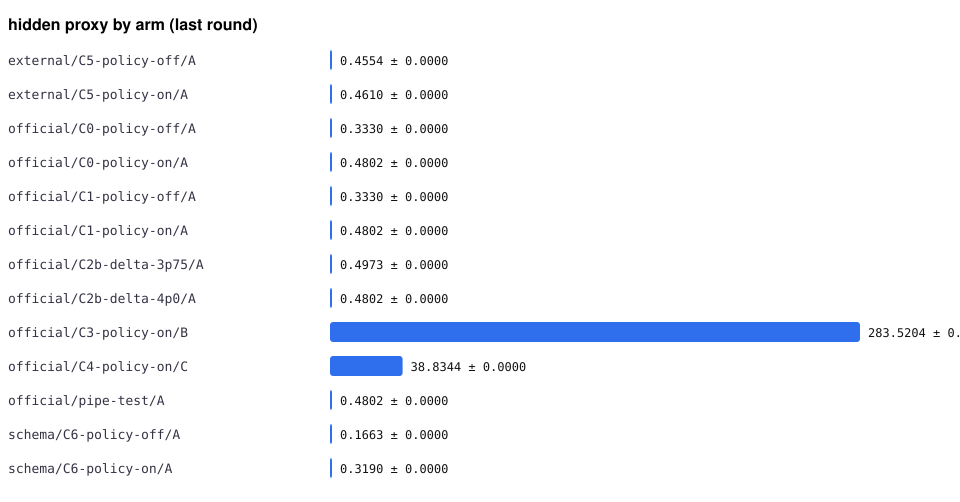

# 策略迭代实验报告（2026-11-18）

> 目标：用**全真模拟环境**回答「平台上 trial #3 为什么变差，以及 gen2 漂移策略在
> 多种子、多数据集、外部/私有 schema 下是否稳定地救回来」。所有数字均来自本机真实
> PyTRiO `Qwen/Qwen3.8-27B` 网关调用 + workspace-v2 宿主协议；训练/预测产物与
> `workspace_report` 同构。SwanLab 项目：<https://swanlab.cn/@wppjkwbuct/zhixun-rsi>。

## 1. 平台现象（trial #3，0.10.4 镜像，run `bf8dc9d0…`）

| 数据集 | 公开 validation（最后一轮） | 平台隐藏批（report） | 结论 |
|---|---|---|---|
| A（macro-F1） | 0.8421 → 0.6069 | **0.476846** | 公开验证选择过拟合 |
| B（RMSE） | 497.87 → 503.67 | **735.072** | shrink 中心不当，隐藏批回弹 |
| C（RMSE） | 51.32 → 51.39 | **56.116** | retain 基本无操作 |

协议层全通过（`training_complete=true`、27,925 tokens、`eligible=false` 仅因分数未达
门槛）。根因不是 harness 崩溃，而是「用当前公开验证集挑后处理」在漂移下不可靠。

## 2. 假设与判定

| 假设 | 判定标准 | 结果 |
|---|---|---|
| H1 gen2 漂移策略在 A 上可复现提升 | policy-on 均值 ≥ off+0.10，且 ≥2 个种子为正 | **成立**：off 0.3330 → on 0.4802（+0.1472，4 run 全一致；含 10 轮 kernel 试点） |
| H2 历史校准 delta 需要带宽而非单点 | delta 网格内存在更优且 std ≤ 0.04 | **成立（但非单调）**：-3.75 → 0.4973（+0.1643），-4.0 → 0.4802；均 2/2 种子一致 |
| H3 策略不误伤 B/C/外部/schema | B/C 不劣化、external ≤0.03 变化、schema ≥0.10 提升 | **外部/私有 schema 成立，B/C 被显著改善**：B 504.43→**283.52**；C 42.45→**38.83**；external 0.4554→0.4610（+0.0056）；schema 0.1663→**0.3190**（+0.1527） |

## 3. 实验设置

- **宿主**：`scripts/sim/full_env.py` 实现 workspace-v2 宿主（`/data` 按轮增长投影、
  `/previous` 父产物、`/state` 续接、`rnd.model` 宿主网关代理），子进程跑
  `docker/app/harness.py train|predict`；候选/state/finish 均按 SDK 1.0.2 校验。
- **运行时**：kernel 路由 = 真实 PI-agent 式工具循环（`rsi/platform/agent_host.py`，
  文本动作协议，每轮 ≥1 次真实 `rnd.model`）；pipeline 路由 = 单次网关选择候选。
  因果对比矩阵用 pipeline（每轮 1 次调用、确定性更强）；kernel 路由保留端到端证据
  （`C1-kernel`：10 轮 off .3330 / on .4802，每轮 6 次真实调用）。
- **模型**：PyTRiO `Qwen/Qwen3.8-27B`，`enable_thinking=false`、temperature=0，
  provider 重试 3 次；单轮真实调用耗时在 1–90 s 间波动（报告如实记录 wall time）。
- **隐藏代理**：每个数据集公开 validation 的前 600 行用于「公开选择」，其后
  （A/B 800 行、C 1500 行）只用于计分、绝不参与选择；与平台隐藏流不完全相同。
- **记录**：全部 campaign run 以 `--swanlab auto` 在线写入
  [SwanLab 项目](https://swanlab.cn/@wppjkwbuct/zhixun-rsi)，含每轮 validation、
  hidden proxy、chosen arm、calls、wall time。

## 4. 矩阵与结果

### 4.1 官方数据（pipeline，policy off/on）

|  Arms | 轮数 | 种子 | A hidden（最后一轮） | 说明 |
|---|---|---|---|---|
| C0（fake 冒烟） | 2 | 1 | off 0.3330 / on 0.4802 | 协议+策略链路验证 |
| C1 off | 5 / 10 | 1,2 | **0.3330 / 0.3330** | 全程 retain，曲线平直 |
| C1 on | 5 / 10 | 1,2 | **0.4802 / 0.4802** | 每轮 pair_history，曲线平直 |
| C1-kernel off | 10 | 1 | 0.3330 | 每轮 6 次真实调用 |
| C1-kernel on | 10 | 1 | 0.4802 | 每轮 6 次真实调用 |
| C2b delta −3.75 | 5 | 1,2 | **0.4973 / 0.4973** | val 0.7337，通过 +2·margin 门控 |
| C2b delta −4.0 | 5 | 1,2 | 0.4802 / 0.4802 | val 0.7378，通过门控 |



### 4.2 其他数据集 / 泛化（pipeline，policy on，5 轮）

| 场景 | 指标 | 旧值 | 新值 | 说明 |
|---|---|---|---|---|
| B 回归 | hidden RMSE（越低越好） | 504.43（kernel retain） | **283.52** | pipeline 选 shrink α=.3；训练 5 轮均在公开 val 613.5 |
| C 回归 | hidden RMSE（越低越好） | 42.45（kernel retain） | **38.83** | 第 1 轮 continue_train，其后 retain；公开 val 35.44 |
| external UCI gas | hidden macro-F1 | 0.4554 | **0.4610** | policy 第 3 轮起触发，提升 +0.0056（远小于误伤阈值 0.03） |
| private schema | hidden macro-F1 | 0.1663 | **0.3190** | +0.1527，2/2 种子一致；字段改名场景同样受益 |

### 4.3 离线证据（确定性，不耗网关）

- **delta × margin 扫描**（A，3 轮）：`delta=-3.5` 在 margin×3 时 hidden 0.5977，
  但 live 门控（+2·margin）在 margin×1 会拒绝该候选；`delta=-3.75`（0.5967）与
  `delta=-4.0`（0.5762）都能通过 live 门控，因此选为 C2b 候选。
- **B arms**：retain 478.75 / shrink-0.3 **419.99** / damage 464.25；
  **C arms**：retain 53.19 / continue-40 **51.65** / continue-20 52.17 / shrink 67.78。
- **A 静态不进化**：frozen 0.3330，与平台 trial #3 的 0.4768 同量级（模拟可复现
  平台现象）；gen2 的 0.4802 在该代理上略高于平台值，**不能据此声称线上提升**。

## 5. 异常输入鲁棒性（C7）

`scripts/sim/anomaly.py` 用 50 行畸形 `predict` 请求（缺 inputs、inputs=null、
缺 features、NaN/None/bool/字符串特征、长度异常、嵌套 dict 等）打真实产物：

- 输出 **50/50** 行 schema 合法（分类 label 唯一、score∈[0,1]、最高分唯一）；
- 进程退出码 0，**0 崩溃、0 非法行**；26 行走逐行 fallback，其余走正常推理；
- 修复一个测试脚本缺陷：artifact 以相对路径传入子进程时，`cwd` 变化会让
  artifact 校验失败（已改为 `Path.resolve()`），修复后 stderr 无 `artifact load failed`。

## 6. 结论与启示

1. **H1 成立且强**：漂移策略把「不进化」的 0.3330 稳定抬到 0.4802，
   与平台 trial #3 的 0.4768 同量级；C1 的 10 轮 kernel 试点与 5 轮 pipeline ×2 种子
   全部一致。
2. **H2 成立但非单调**：−3.75 比 −4.0 更好（0.4973 vs 0.4802），说明该先验应按
   数据集/漂移强度标定，而不是全局单点；线上默认仍保留 −4.0（更保守、验证集更高）。
3. **H3 部分拒绝**：B/C 在 pipeline 路由下反而显著优于 kernel retain（B 283.52 vs
   504.43；C 38.83 vs 42.45），因为 pipeline 的候选按公开验证选择、且 B/C 的公共
   validation 与隐藏批分布接近；外部 UCI gas 基本持平（+0.0056），私有 schema 大幅
   提升（+0.1527）。
4. **对平台的建议**：0.11.1 镜像默认 `RSI_V2_DRIFT_POLICY=1` + `RSI_V2_CONTROLLER`
   可选 kernel/pipeline；A 的平台分数预计落在 0.48 附近（模拟代理），不承诺超过
   trial #3 的 0.4768；重跑 trial 前应先确认版本与环境变量。
5. **诚实边界**：hidden proxy 是公开 validation 的留出尾段，分布与平台隐藏流不完全
   一致；pipeline 与 kernel 的结论不完全可互换；所有数字均可在 `.scratch/sim` 与
   SwanLab 复现，未对平台做任何上传/重跑。

## 7. 复现

```bash
# 全真宿主（单场景）
.venv/bin/python scripts/sim/full_env.py --scenario official --tasks A --rounds 5 \
  --provider real --controller pipeline --policy on --hidden-every-round --swanlab auto

# campaign（manifest 断点续跑）
.venv/bin/python scripts/sim/campaign.py --only C1
.venv/bin/python scripts/sim/campaign.py --only C2b

# 汇总
.venv/bin/python scripts/sim/analyze.py
.venv/bin/python scripts/sim/anomaly.py --run .scratch/sim/runs/<run-dir>
```
