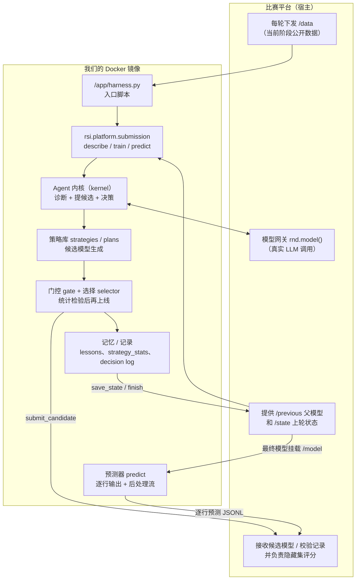
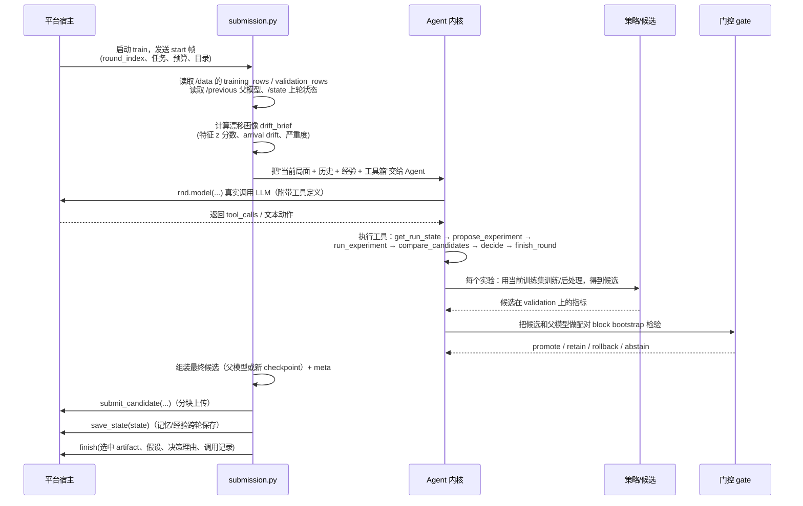
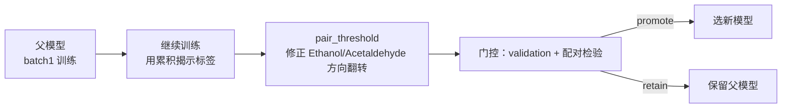
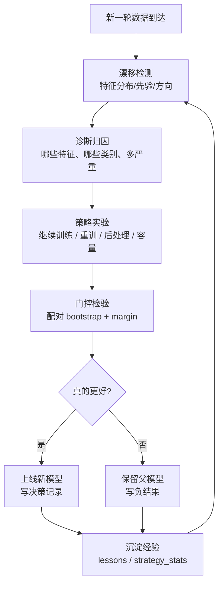
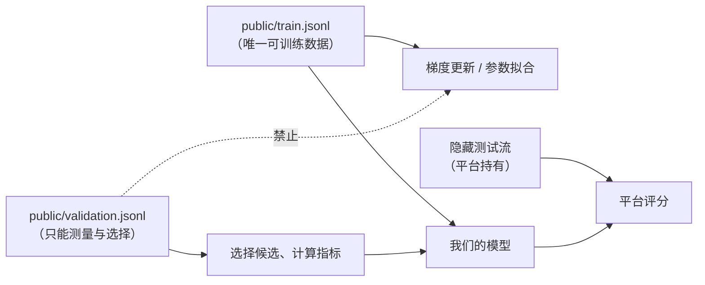

# 智训引擎 RSI Harness 说明（小白版）

> 一句话：我们的程序不是“一个训练好的模型”，而是一套**会自己看数据、自己提方案、自己做实验、自己决定要不要上线**的系统。比赛平台每轮把新的数据交给我们，我们每轮都完整走一遍“发现漂移 → 诊断 → 实验 → 门控 → 沉淀经验”，然后把本轮选出的模型交给平台。
>
> 当前版本：**v0.14.12** ｜ 代码仓库：<https://github.com/JackWPP/zhixun-harness> ｜ 镜像：`zhixun-rsi-harness:0.14.12`

---

## 1. 先搞懂比赛在考什么

比赛给了三个工业任务：

| 任务 | 类型 | 指标 | 数据长什么样 |
|---|---|---|---|
| **A** 气体传感器漂移 | 分类（6 类气体） | macro-F1（越高越好） | 传感器会老化、漂移，同一类气体的特征分布会变 |
| **B** 轴承剩余寿命 | 回归（RUL，分钟） | RMSE / MAE（越低越好） | 不同轴承退化速度不同，末期预测特别容易错 |
| **C** 航空发动机剩余寿命 | 回归（RUL，cycle） | RMSE / NASA score（越低越好） | 测试单元和训练单元完全不是同一批，且 NASA 对“晚期高估”的惩罚极重 |

难点不在“训练一个模型”，而在于：

1. 数据是**一轮一轮**给的，而且越晚的数据分布越偏（漂移）；
2. 隐藏测试集不公开，不能靠“调参调到隐藏分高”；
3. 每一轮都必须真的调用平台提供的大模型（证明是 Agent 在决策），还要留下可追溯的记录；
4. 不能作弊：训练只能用公开训练集，验证集只能用来“测量/选择”，不能拿去训练或拟合后处理参数。

---

## 2. 整体架构：谁在干活



把它想成一家小工厂：

- **平台** = 客户，每轮送来新原料（数据），要求我们交一个“当前最好的模型”；
- **`/app/harness.py`** = 工厂大门，平台只会喊三个命令：`describe`（你好，我是谁）、`train`（做一轮）、`predict`（开始预测）；
- **submission.py** = 车间主任，负责搬数据、找模型、组装候选、写记录；
- **Agent 内核** = 工程师，负责看数据、写假设、提方案、拍板；
- **策略库** = 工具箱（继续训练、后处理、重训、容量调整……）；
- **门控** = 质检员，只有“统计上确实更好”的候选才允许替换父模型；
- **记忆/记录** = 实验日志，下一轮工程师可以翻看上一轮的经验。

---

## 3. 一次 `train` 到底发生了什么（时序图）

平台每轮会启动一个**新进程**，把这一轮的数据和上下文通过“帧（frame）”喂进来。我们的程序按下面的顺序走：



几个关键设计（说人话）：

- **Agent 有“工具”**：它不能随便写代码/上网，只能调用我们给的 19 个受控工具（看状态、查历史、查经验、提实验、跑实验、比较、决策、记忆……）；
- **实验是受控的**：每轮最多 3 个实验，工具箱里只有白名单策略，参数也有范围；
- **门控不是“分数高就上”**：比父模型好多少、误差多大、块与块之间稳不稳，都要过统计检验；否则宁可 `retain`（保留父模型）——**不进化好过乱进化**；
- **每轮至少一次真实 LLM 调用**，所有 `call_id` 都写进 `finish` 记录，保证“Agent 真的在决策”。

---

## 4. 一次 `predict` 怎么跑

训练结束后，平台会把选中的模型挂到 `/model`，然后逐行问我们。

```mermaid
flowchart LR
    A["平台逐行输入<br/>{\"task\":..., \"inputs\":{...}}"] --> B["predict 逐行处理"]
    B --> C{"有没有 checkpoint?"}
    C -- 有 --> D["加载官方 checkpoint（v1 单隐层 MLP）"]
    C -- 没有 --> E["退化预测（保守兜底）"]
    D --> F["特征展开 + 后处理流<br/>(recenter / pair / shrink…)"]
    F --> G["分类：唯一最高分<br/>回归：非负有限值"]
    E --> G
    G --> H["输出一行 JSON 并 flush"]
```

预测侧有几个硬性要求（平台会逐行校验）：

- 分类：每行一个非空标签，分数在 0~1，**最高分必须唯一**；
- 回归：输出一个**非负、有限**的数值；
- stdout 只能写协议 JSON，日志必须走 stderr；
- 单行出错不能让整条流崩掉 → 我们有逐行兜底（fallback）。

---

## 5. 三个任务分别怎么打（当前最终配置）

我们的策略不是“一个模型打天下”，而是**逐任务选择最适合的候选**，再靠门控确认。

### A：气体分类（漂移最严重）



- A 的核心问题是**类别条件漂移 + 方向反转**（Acetaldehyde 和 Ethanol 的判定边界会翻）；
- 最终策略：先继续训练适应新分布，再用固定历史阈值做 pair 修正；
- 最终隐藏成绩：**macro-F1 ≈ 0.895**（父模型基线约 0.714）。

### B：轴承 RUL（静态后处理会翻车）

- 父模型在验证集 RMSE 681，但隐藏集 720；
- 旧的 `shrink` 后处理在验证集上很漂亮（498），但在隐藏集晚期低 RUL 段反而把误差推到 556 → 被我们停用；
- 最终策略：**从公开训练集重训一个 h=80 的官方 v1 模型**（scratch），隐藏 RMSE **155.17**，MAE 117.33，是静态基线 720 的 **4.6 倍**提升。

### C：发动机 RUL（NASA 惩罚尾巴）

- C 的验证集 RMSE 52.87，父模型隐藏 RMSE 56.23；
- 我们试过重训（scratch）把验证 RMSE 降到 51.2，但隐藏集 **NASA score 从 4.26e10 恶化到 9.24e10**（少数超长 RUL 样本被低估，指数惩罚爆炸）；
- 最终决策：**C 全程 retain 父模型**（baseline-safe），保证“不低于静态基线”这条 gate，同时避免 NASA 爆表；代价是 C 的增益为 0。

> 一句话总结三任务：A 用“适应 + 修正”，B 用“重训”，C 用“不动”。这不是拍脑袋，是逐个用本地同构管线和统计检验验证出来的。

---

## 6. 自进化到底进化了什么



三层进化：

1. **数据层**：把每轮新揭示的标签累积起来，继续训练模型（A 的早期、B 的重训都靠这个）；
2. **策略层**：每轮在工具箱里试几个候选，门控决定去留，结果写入 `lessons` 和 `strategy_stats`，下一轮 Agent 会参考；
3. **记忆层**：用 SQLite + JSONL 记录“什么漂移 → 什么策略 → 什么结果”，并冻结成快照（MEMORY.md / skills），让 Agent 跨轮、跨任务复用。

---

## 7. 目录速查（想改代码看这里）

```text
rsi/
├── platform/submission.py   ← 平台入口：describe/train/predict 全在这里
├── platform/agent_host.py   ← 把平台的 rnd.model 包装成 Agent 运行时（原生 tool_calls / 文本动作 / 降级）
├── platform/plans.py        ← 候选模型工厂（recenter/pair/continue/scratch/capacity）
├── agent/                   ← Agent 内核：kernel、工具、prompt、guard、记忆接入
├── eval/                    ← 统计与门控：block bootstrap、evidence gate
├── inference.py             ← 后处理实现（recenter/pair/shrink/damage）
├── model.py                 ← 官方 v1 单隐层 MLP（训练/保存/加载）
├── capacity.py              ← 容量实验模型（可换 loss/宽度，最终转回官方 v1）
├── memory/                  ← 记忆、技能、经验检索
├── drift.py                 ← 漂移检测
├── strategies.py/executor.py← 策略注册与实验执行
├── runner.py                ← pipeline 控制器（不带 LLM 的确定性路径）
└── dashboard/               ← 本地可视化面板

docker/
├── Dockerfile               ← 镜像构建
└── app/harness.py           ← 平台入口脚本（调用 contest_harness.cli）

scripts/sim/                 ← 本地全真模拟器（不花比赛额度）
├── full_env.py              ← 模拟平台宿主（SDK v2 协议、分块上传、模型网关）
├── campaign.py              ← 批量实验矩阵
├── datasets.py              ← 官方/外部/私有 schema 数据集包
└── capacity_lab.py          ← 离线容量实验

vendor/contest_harness-1.0.4/ ← 官方 SDK（比赛方提供，别改）
tests/                        ← 215+ 回归测试
docs/                         ← 设计、实验、复盘文档（43/46 是最终材料核心）
```

---

## 8. 怎么运行（本地/镜像/平台）

### 8.1 构建和自检镜像

```bash
bash scripts/stage_image.sh
python scripts/build_image_tar.py --tag zhixun-rsi-harness:0.14.12
bash scripts/verify_image.sh          # 会跑 describe + 一轮 fake host + 离线 A 两轮
```

### 8.2 本地全真模拟（不消耗比赛额度）

```bash
# 官方三任务，各 3 轮，用真实模型网关
.venv/bin/python scripts/sim/full_env.py \
  --scenario official --tasks A,B,C --rounds 3 \
  --provider real --controller kernel --swanlab auto

# 批量矩阵（断点续跑）
.venv/bin/python scripts/sim/campaign.py --matrix scripts/sim/campaigns-final.json
```

### 8.3 平台会怎么调用我们

```bash
python3 /app/harness.py describe   # 打印一行 JSON：协议版本、任务列表
python3 /app/harness.py train      # 平台通过 stdin 发送 start 帧，我们走完一轮
python3 /app/harness.py predict    # 平台逐行发送样本，我们逐行返回
```

### 8.4 关键环境变量（不需要改代码）

| 变量 | 作用 | 当前值 |
|---|---|---|
| `RSI_V2_CONTROLLER` | 控制器：auto/kernel/pipeline | `auto`（分类走 Agent，回归走确定性管线） |
| `RSI_V2_MAX_TURNS` | Agent 最大工具轮次 | `10` |
| `RSI_V2_NATIVE_TOOLS` | 用原生 tool_calls（1）还是文本动作（0） | `1` |
| `RSI_V2_KERNEL_THINKING` | Agent 调用是否开 thinking | `off`（平台 256 输出预算下必须关） |
| `RSI_V2_MAX_OUTPUT` | 单次 LLM 最大输出 token | `256` |
| `RSI_V2_CAPACITY_ARM` | 容量实验臂 | `ls10` |
| `RSI_V2_SCRATCH_ARM` | B/C 重训臂 | `on` |
| `RSI_V2_WARMUP_ROUNDS` | 前 N 轮强制保留父模型 | `0`（formal 实测有害，已关） |
| `RSI_V2_PROBE_RETAIN` | 强制某任务 retain（探针用） | `C` |
| `RSI_V2_B_RETAIN` / `RSI_V2_B_STATIC` | B 的 retain / 静态后处理开关 | `0` / `0` |

---

## 9. 合规边界（比赛最看重的部分）



- 训练只用 `public/train.jsonl`；验证集只能测量/选择，**不能**参与训练或用来拟合后处理参数；
- 不用外部数据（外部数据只在本地测试床用，镜像里默认关闭）；
- 每轮真实调用模型网关，记录 `call_id`；
- 镜像限制：2 核 4 GiB、产物 ≤512 MiB（分块上传）、不联网；
- 所有提交物（镜像、文档、实验记录）保留在平台与 GitHub，可复现。

---

## 10. 我们目前的成绩与证据

| 项 | 数值 |
|---|---|
| 最终镜像 | 0.14.12，381,050,880 B |
| 三任务隐藏指标（最近一次 trial） | A macro-F1 **0.8947**；B RMSE **155.17**（基线 720）；C RMSE **56.23**（retain，基线口径） |
| 正式评测 #3 总分 | **56.65**（此前 45.74 / 45.18） |
| 客观分 | 12.09 / 35（mean_gain 3.35、recovery 3.37、retention 5、worst_stage 0.37、resource 0） |
| gates | `not_below_static_baseline` 已翻为 **true**；仍待人工核验 `experiment_records_complete`、`complete_materials_and_reproducibility` |
| 测试 | 217 passed, 3 deselected |
| 实验量 | 本地同构管线 100+ run，真实网关调用数千次；SwanLab 公开记录 |

---

## 11. 一句话看懂这个 harness

> 它像一个**会做实验的工程师**：每轮先看数据有没有变，再提出几个改进方案，真的动手训练/验证，用统计检验判断有没有变好，把结论和“踩过的坑”写进经验库；下一次它会更聪明。模型只是它的“手”，决策和进化才是它的“脑”。

---

## 12. 名词表（读文档时对照）

| 名词 | 说人话 |
|---|---|
| 漂移（drift） | 新数据和旧数据“长得不一样了”，模型会变笨 |
| 候选（candidate） | 本轮做出来的新模型/新后处理方案 |
| 门控（gate） | 质检：只有统计上确实更好才允许上线 |
| retain | 保守选择：这轮不改，继续用父模型 |
| 父模型 / checkpoint | 上一轮留下的、平台认可的模型文件 |
| workspace_report | 每轮训练+预测+指标的完整记录 |
| `rnd.model` | 平台给的大模型调用接口（Agent 的“大脑外挂”） |
| 分块上传 | 新 SDK 要求的提交方式（先声明、再分块、再完成） |

---

*文档版本：v0.14.12 ｜ 最后更新：2026-11-23*
