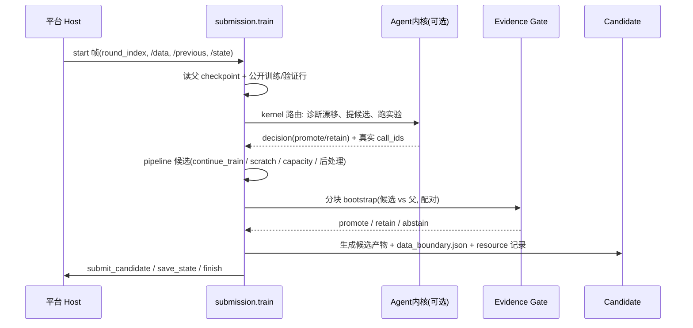

# 智训引擎 RSI Harness — 交接文档（Handoff）

> 最后更新：2026-11-25 · 对应代码版本 **v0.14.12** · 仓库 <https://github.com/JackWPP/zhixun-harness>
>
> 用途：当前 formal / trial 额度均已用尽（formal 3/3，trial 10/10），等待平台 reset。
> 额度恢复后，接手人按本文 §8 行动即可继续迭代；§7 是平台操作手册，§6 是不能碰的合规红线。

---

## 0. 一分钟速览

| 项 | 值 |
|---|---|
| 我们做到什么 | 一个可以在比赛平台里"自主训练 + 自我评估 + 选择上线/回滚"的 Docker RSI harness |
| 最近一次正式成绩 | **56.65 / 100**（formal#3，run `1d679070f34badfdf0dd9a77086cdb96`，eligible=false） |
| 实时榜 | 48 支有成绩队伍中**第 14 名**；北化 3 队里第 1（56.65 / 55.57 / 54.22） |
| 距 Top10 | 差 2.79 分（Top10 门槛 59.44） |
| 三个数据集（同一 submission 的试运行隐藏分） | A Macro-F1 **0.8947**（基线 0.7140）；B RMSE **155.17**（基线 720.07）；C RMSE **55.89**（父模型基线 56.23） |
| 卡在哪里 | 客观分 12.09/35 偏低；两个**人工审核 gate**（records / materials）一直是 false，不是代码问题 |
| 额度 | formal 3/3 用尽、trial 10/10 用尽，**等 reset** |
| 代码状态 | main 干净，tag `v0.14.12`，测试 **217 passed, 3 deselected** |
| 一切证据的索引 | `docs/39`→`docs/49`；原始数据在 `.scratch/`（已 gitignore） |

---

## 1. 比赛与平台规则摘要

- **赛题**：工业模型自进化（RSI）。在"漂移数据流"上，无人干预地自动训练、验证、选择并维持模型性能。
- **运行时协议**：`contest.harness.workspace.v2`，官方 SDK **1.0.4**（我们 vendored 在 `vendor/contest_harness-1.0.4/`）。
- **镜像约束**：`docker save` 的未压缩单 tar（不能 `docker export`、不能压缩）；≤ 2GB；离线 4C8G（SDK 文档 1.0.4 写的是 2 核 / 4GiB 沙箱）。
- **入口**：`python3 /app/harness.py describe | train | predict`；选手模块 `/app/contest_submission.py` 导出 `TASKS` / `train(rnd)` / `predict(sample, model_dir)`。
- **评测结构**：A / B / C 三个数据集，各 10 个检查点（rounds=10），权重各 1/3。
  - A：UCI gas 传感器漂移，分类，主指标 macro-F1（需求 accuracy + macro_f1）。
  - B：XJTU-SY 轴承 RUL（分钟），回归，主指标 RMSE（需求 rmse + mae）。
  - C：CMAPSS 涡扇发动机 RUL（cycles），回归，主指标 RMSE（需求 rmse + nasa_score）。
- **预算**：wall 21600s、token 8,000,000、label budget 9628。
- **计分**（`/scoring-rulesets`）：
  - 客观分 35 = mean_gain 15 + recovery 5 + resource_efficiency 5 + retention 5 + worst_stage 5。
  - 主观分 65 = autonomous 10、drift_detection 8、route_selection 6、safety_controls 6、system_quality 6、technical_report 6、experiment_records 5、controlled_experiments 5、record_based_analysis 5、defense 4、industrial_constraints 4。
  - bonus 10 = extended_data_validation 5 + technical_innovation 5。
  - **5 个 gate**（影响 eligible / 入榜）：autonomous_completion_on_time、experiment_records_complete、three_traceable_decision_cycles、not_below_static_baseline、complete_materials_and_reproducibility。
- **数据边界（硬红线，违反会被判 contestant）**：
  1. 梯度训练只能用 `public/train.jsonl`；`public/validation.jsonl` 只能"测量 / 选择"，**不能并入训练**。
  2. 不能用标签拟合推理期统计（例如在 train 标签上网格搜索 pair 阈值再塞进 meta —— 我们踩过这个坑，见 §6）。
  3. 续训必须从官方 baseline 父检查点出发，保留真实父链；产物 ≤64MiB、checkpoint.npz。
  4. 每轮至少一次真实 `rnd.model()` 调用，`model_call_ids` / `history_ids` 必须真实。

---

## 2. 交付物与版本状态（照抄即可复现/续传）

### 2.1 Git

```
repo:   https://github.com/JackWPP/zhixun-harness
branch: main
tag:    v0.14.12        # 最终提交的镜像版本
最近提交：e23b9cc docs: platform API intelligence report ...
工作区：干净
```

### 2.2 最终镜像

| 项 | 值 |
|---|---|
| 版本 | 0.14.12 |
| 本地 tar | `.scratch/image/harness.tar` |
| 大小 | 381,050,880 B |
| sha256 | `f8ff0417c937eea6957dde33518a672c0c9405a8cc386f78a60401dff9b90a89` |
| 平台 archive | `1eae63b3990429855fd80fe4b38626e7`（ready） |
| 构建命令 | `bash scripts/stage_image.sh && python scripts/build_image_tar.py --rootfs .scratch/image/rootfs --overlay .scratch/image/overlay --output .scratch/image/harness.tar --tag zhixun-rsi-harness:0.14.12` |
| 验证命令 | `bash scripts/verify_image.sh` → 期望 PASS（describe sdk 1.0.4、fake-host、离线 A 两轮 metric 0.7345546845546845） |

### 2.3 平台提交物

| 对象 | id | 说明 |
|---|---|---|
| document | `6758ff3df369f201a1dfb05dbbed02e4` | `zhixun-rsi-harness-v0.14.12-final-materials.md` |
| submission | `2560f93aec8b5ba4e099ce86e96b4429` | v15，0.14.12，status=valid，已 select 为正式版本 |
| 最近 formal run | `1d679070f34badfdf0dd9a77086cdb96` | attempt 3，completed，56.65，eligible=false |
| 最近 trial run | `05a5d838af1568475fc5708ce698f7ba` | 0.14.11 最终配置，completed，无违规 |
| probe trial | `d401a95a39780ac734b5343fe3548232` | 0.14.10，`RSI_V2_PROBE_RETAIN=C`，用于测 C 父模型隐藏基线 |

### 2.4 总分与分项（最近一次 formal）

| 组件 | 得分 |
|---|---|
| mean_gain | 3.3459 / 15 |
| recovery | 3.3730 / 5 |
| resource_efficiency | 0 / 5 |
| retention | 5 / 5 |
| worst_stage | 0.3715 / 5 |
| **objective_score** | **12.0904 / 35** |
| gates | autonomous ✅ / three_cycles ✅ / **not_below_static_baseline ✅** / records ❌ / materials ❌ |
| 最终 | 56.65，eligible=false |

三次 formal 的分数轨迹：**45.74 → 45.18 → 56.65**（前两次 C scratch 触发 `not_below` false，第三次 C 改 retain 后翻 true）。

---

## 3. 代码架构（先看这一节，再看代码）

### 3.1 一句话版本

**平台**通过 `harness.py` 每轮把"当前可见数据 + 父模型"交给**我们的 submission**；submission 内部有两条路：

1. `kernel` 路由：真正让 Qwen3.8-27B（经平台网关）当 Agent，自己诊断漂移、提候选、跑实验、决定 promote/rollback；
2. `pipeline` 路由：确定性候选生成 + 门控（回归任务/降级兜底用）。

两条路产出的候选都要过 **evidence gate**（分块 bootstrap 置信区间 + margin），才能替换父模型；然后写候选产物、state、历史和 finish。

### 3.2 目录地图

| 路径 | 作用（重点看） |
|---|---|
| `docker/app/harness.py` | 平台入口，转发 `describe/train/predict` 给 SDK CLI |
| `docker/app/contest_submission.py` | 选手模块，导出 `TASKS` / `train` / `predict` |
| `rsi/platform/submission.py` | **核心**。train 主流程、候选生成、gate、drift policy、probe retain、predict 流式适配 |
| `rsi/platform/plans.py` | 候选计划库（recenter / shrink / pair / continue_train / scratch_retrain / capacity） |
| `rsi/agent/` | PI agent 运行时：`kernel.py`（一轮）、`actions.py`（19 个工具）、`agent_host.py`（网关 RPC→Agent 适配）、`prompts_kernel.py`、`guard.py` |
| `rsi/model.py` / `rsi/capacity.py` | 官方 v1 MLP（单隐层 tanh）与扩展容量模型 |
| `rsi/inference.py` | 后处理与流式适配器（RecenterStream / PairThresholdStream / PostprocessStream / damage） |
| `rsi/eval/` | 指标口径（固定类）、分块 bootstrap、evidence gate |
| `rsi/metrics.py` / `rsi/selection.py` / `rsi/drift.py` | 指标、门控、漂移诊断 |
| `rsi/memory/` / `skills/` / `knowledge/` | Agent 的记忆、技能、知识库（跨轮沉淀） |
| `scripts/sim/full_env.py` | **本地比赛同构模拟器**（workspace v2 + chunked 上传 + 真 provider 网关） |
| `scripts/sim/campaign.py` | 批量实验调度（manifest、断点续跑、种子、SwanLab） |
| `scripts/emulate_workspace_v2.py` | 轻量 emulator（fake provider） |
| `scripts/stage_image.sh` / `build_image_tar.py` / `verify_image.sh` | 无 docker daemon 的镜像构建/校验流水线 |
| `vendor/contest_harness-1.0.4/` | 官方 SDK（分块上传协议） |
| `datasets/` | 官方 A/B/C 数据包 |
| `docs/` | 01–50 全部文档（见 §5.4 索引） |

### 3.3 一轮 train 的时序（简化）



---

## 4. 本地怎么跑（无 Docker daemon 也能全套跑通）

```bash
cd /home/xgx/wpp1/zhixun-harness
source .venv/bin/activate            # Python 3.12，已装依赖

# 1) 全量测试（基线：217 passed, 3 deselected）
pytest -q -m "not integration"

# 2) 轻量 emulator（fake provider，验证协议/候选/门控）
python scripts/emulate_workspace_v2.py --task A --rounds 3
python scripts/emulate_workspace_v2.py --task B --rounds 3
python scripts/emulate_workspace_v2.py --task C --rounds 3

# 3) 比赛同构模拟（真 provider；provider 配置见 §9）
python scripts/sim/full_env.py --scenario official-seq --tasks A --rounds 10 \
  --provider real --controller kernel --swanlab auto --seed 0 --tag my-run

# 4) 批量实验（campaign 矩阵）
python scripts/sim/campaign.py --matrix scripts/sim/campaigns-final6.json

# 5) 镜像构建 + 校验（不需要 docker daemon）
bash scripts/stage_image.sh
python scripts/build_image_tar.py --tag zhixun-rsi-harness:0.14.12
bash scripts/verify_image.sh
```

### 4.1 关键环境变量（镜像默认值，`docker/Dockerfile`）

| 变量 | 默认 | 作用 |
|---|---|---|
| `RSI_V2_CONTROLLER` | `auto` | 分类走 kernel、回归走 pipeline |
| `RSI_V2_MAX_TURNS` | 10 | Agent 每轮最多交互轮数 |
| `RSI_V2_KERNEL_TOOLS` | `core` | 内核工具白名单（省 token） |
| `RSI_V2_KERNEL_THINKING` | `off` | 256 输出预算下必须 off |
| `RSI_V2_NATIVE_TOOLS` | `1` | 用原生 tool_calls（否则文本 JSON 协议） |
| `RSI_V2_SCRATCH_ARM` | `on` | B/C 从零重训候选 |
| `RSI_V2_CAPACITY_ARM` | `ls10` | A 分类容量候选（label smoothing .1） |
| `RSI_V2_WARMUP_ROUNDS` | **0** | 前 N 轮强制父模型（**formal#2 证明有害，别开**） |
| `RSI_V2_PROBE_RETAIN` | `C` | 强制 C 保持父模型（为了 `not_below` gate） |
| `RSI_V2_B_RETAIN` / `RSI_V2_B_STATIC` | 0 / 0 | B 的 retain-only / 静态后处理开关 |
| `RSI_V2_MAX_OUTPUT` | 256 | 平台网关输出预算 |

---

## 5. 已有结果与证据

### 5.1 三个数据集的最终配置与隐藏指标

| 任务 | 最终策略 | 隐藏指标 | 静态基线 | 备注 |
|---|---|---|---|---|
| A | kernel + 累积标签 continue_train + recent-holdout + pair_history | Macro-F1 **0.8947** | 0.7140 | 最稳，11 seeds 均值 0.7192（本地模拟）→ 平台 0.8947 |
| B | pipeline + scratch_retrain（单隐层 tanh h80, 600 epoch） | RMSE **155.17** / MAE 117.33 | 720.07 / 726.04 | 4.6× 优于基线；0.14.7 B retain 为 720.07 |
| C | retain 父模型（baseline-safe） | RMSE 55.89 / NASA 9.24e10 | 56.23 / 4.26e10 | 唯一能翻 `not_below` 的配置；scratch 在 NASA 上更差 |

### 5.2 重要的本地实验结论（别再重复踩）

- **A**：`/data` 按轮累积揭示标签（pair 校准行数 346→1065 可证）；最大的杠杆是"用已揭示标签继续训练"，不是无标签 TTA。
- **B**：静态 shrink（把预测往 train 均值拉）在晚期低 RUL 段反向恶化——hidden 735 vs retain 720；真正有效的是 scratch h80（验证 474.37），平台 hidden 155.17。
- **C**：hidden NASA 被极少数"超长 RUL、被严重低估"的行主导（err≈−300，exp(−err/13) 爆炸）；验证集最大 RUL 434，隐藏流有分布外外推。重加权/重采样会让 NASA 爆到 1e13+；无标签/无 trial 条件下 **C 没有安全的大杠杆**，retain 是风险最优。
- **局部代理陷阱**：本地 `validation[600:]` 之类的 hidden proxy 与平台隐藏流口径不同（曾用 3 类 644 行得出 +0.147，后被红队推翻）；只能做**相对/配对**比较，不能当绝对分。

### 5.3 正式评审踩过的 3 次合规问题（已修，勿复发）

1. **train 标签拟合推理期统计**：`FIT_PAIR` 在 train 标签上网格搜索 pair delta → 判 contestant。修法：predict 只用固定历史 delta（`PAIR_HISTORY_DELTA=-4.0`），`plans._resolve_postprocess` 缺 delta 直接返回 none。
2. **验证集进梯度**：`_candidate_plans` 对 B/C 的 continue_train 误把 validation 当 x_train → 判 contestant。修法：`fit_x/fit_y` 只用 public train；`_assert_training_only`；候选目录写 `data_boundary.json`（含 id 指纹、`validation_used_for_fit=false`）。
3. **gate 方向反了**：regression 的 lower-is-better 未归一化 → 会 promote 更差 RMSE。修法：`_improvement()` 统一成"正值=更好"，统一按 higher 评估。

### 5.4 文档索引（按主题）

| 主题 | 文档 |
|---|---|
| 比赛/规则/合规 | `docs/01`、`docs/11`、`docs/19_SUBMISSION_CONTRACT.md`、`docs/41`、`docs/43` |
| 架构/运行 | `docs/47_HARNESS_GUIDE.md`（小白向+7 张 Mermaid）、`docs/10_ARCHITECTURE.md`、`docs/13_RUNBOOK.md` |
| A/B/C 专项 | `docs/36`（A 诚实评估）、`docs/42`（B/C 本地探针）、`docs/46`（C 尾部 NASA） |
| 实验与方法论 | `docs/33`、`docs/37`、`docs/38`、`docs/39`、`docs/40` |
| 复盘/教训 | `docs/48_RETROSPECTIVE.md` |
| 平台情报 | `docs/49_PLATFORM_INTEL.md` |
| 组委会沟通 | `docs/45_ORGANIZER_REVIEW_REQUEST.md` |

---

## 6. 合规红线清单（改代码前先读）

- [ ] 训练梯度只碰 `public/train.jsonl`；validation 只用于打分/选择。
- [ ] 任何"用标签算出来的推理参数"都不能落地进 predict（除非本来就在官方 checkpoint 里）。
- [ ] 每轮必须有 ≥1 次真实 `rnd.model()` 调用，`model_call_ids` 来自真实 receipt；`history_ids` ⊆ 已读 history。
- [ ] 候选 checkpoint 只能从父 checkpoint 续训或官方格式重训；写官方 `contest.cpu-mlp.v1`。
- [ ] 候选产物 ≤64 文件 / ≤64MiB；分块上传协议 1.0.4（chunked-v1）。
- [ ] `not_below_static_baseline`：任一数据集不得低于静态基线——C 的最稳做法是 retain。
- [ ] 不要开 `RSI_V2_WARMUP_ROUNDS`（formal#2 实测：worst_stage .3715→0，recovery 4.206→3.730，总分 45.18）。
- [ ] 不要用 validation 标签拟合 postprocess（历史判罚，第二次会直接判 contestant）。

---

## 7. 平台操作手册（team 权限）

### 7.1 认证

```bash
POST https://rsi-index.115.zone/api/v1/auth/login
body: {"username":"<team>","password":"<password>"}
resp: {"identity":..., "token": "<64 hex>"}   # token 存 .scratch/platform/token (0600)
# 所有请求: Authorization: Bearer <token>
```

注意：token 会过期（表现为 401 `会话无效或已撤销`），重新 login 即可。

### 7.2 从构建到正式提交的标准流程

```bash
# 1) 上传镜像（未压缩 tar）
POST /api/v1/image-archives   (Content-Type: application/x-tar, body=harness.tar)
# → archive_id, 等 status=ready

# 2) 上传材料文档（name 必须 ASCII，否则"文档名称无效"）
POST /api/v1/documents  body {"name":"...md","content_base64":"..."}
# → document_id

# 3) 创建 submission
POST /api/v1/submissions  body {model, model_source:"base", base_model_confirmed:true,
  api_key:<PyTRiO key>, image_archive_id, document_id, training_url, source_url}

# 4) 校验 + 选为正式版本
POST /submissions/{id}/validate
POST /submissions/{id}/select

# 5) 发起正式评测（重要：用这个接口，前端也是它）
POST /api/v1/runs   body {"submission_id":"..."}
# → run_id; 轮询 GET /runs/{run_id}/report

# trial（额度允许时）
POST /submissions/{id}/trial
  body {"evaluation_config_id":"76e44dafec4225a250977eed7a48b811",
        "execution":"full_training"}    # 少了 execution 会 409
```

规则语义（来自前端 bundle 与实测）：
- 正式评测最多 3 次，**自动取有效成绩最高的一次**；失败/失效的运行**不占用**次数。
- trial 10 次，**trial 没有 benchmark 分数**（只验证合规/可运行）；`eligible` 由人工 gate 决定。

### 7.3 可读 / 不可读接口

| 可读（team） | 用途 |
|---|---|
| `GET /rules` | 额度、evaluation_config_id、协议、预算 |
| `GET /scoring-rulesets` | 客观/主观权重、数据集指标 |
| `GET /leaderboard/live?mode=formal` | **实时榜单（48 队全量）** |
| `GET /dashboard`、`/schools`、`/teams` | 统计、学校、本队 |
| `GET /announcements?history=true` | 公告历史 |
| `GET /runs`、`/submissions`、`/image-archives` | 本队记录 |
| `GET /runs/{id}/report` | 本队 run 明细（含 training_records、objective_result） |
| `GET /documents/{id}` | 本队文档 |

| 403（管理员域） | 说明 |
|---|---|
| `/scoring-records`、`/objective-snapshots`、`/defenses`、`/datasets`、`/evaluation-configs`、`/runners`、`/audit`、`/leaderboard/export` | 无合法路径，不要尝试绕过 |
| 他队 run/team | 404 |

### 7.4 两个卡人的 gate

`experiment_records_complete` 与 `complete_materials_and_reproducibility` 是**管理员人工审核字段**
（`POST /submissions/{id}/review`，仅 admin 可见；我们 API 里 `records_complete` / `materials_complete` 一直是 null）。
我们的 records 已经逐轮完整（hypothesis / change_summary / configuration / candidates / decision / history_ids /
validation_metrics / 资源），材料见 `docs/43`。**唯一能做的是通过组委会渠道请求人工核验**；草稿在 `docs/45`。

---

## 8. Reset 之后的行动计划（按优先级）

### P0 — 额度一恢复就做（0–30 分钟）

1. `GET /rules` + `/teams` + `/leaderboard/live`：确认 formal/trial 剩余额度、evaluation_config_id 是否变、排名是否变。
2. 若 trial >0：先跑 **1 次 trial** 用当前 0.14.12（C retain）确认无违规、隐藏分与 56.65 那次一致（防平台口径漂移）。
3. 若 formal >0：确认 submission `2560f93a…`（或新版本）仍 selected、材料 document 最新；**至少留 1 次 formal 到最后**。
4. 看 `docs/49` 的 rank/分数快照，判断目标（Top10 需要 59.44+，即再 +2.79）。

### P1 — 技术提升（本地先验证，再花额度）

| 方向 | 具体想法 | 预期 | 风险 |
|---|---|---|---|
| C（最大单点，但最难） | ①单位级交叉验证（106 个 unit 之间划分）选型；②h128 e15 / h64 e600 + 轻度 Huber(δ=80–100) 的**单模型双赢**候选；③对 NASA 尾部做无标签的边界收缩（如按训练分布 clip），**不可用标签拟合** | C hidden RMSE 可能 −0.3~−1.0；NASA 不确定 | hidden 只有 1 次机会验证；gate 可能再被打回；建议 trial 先行 |
| B | 已在 155.17；可试 h96/更大 epoch、或 per-stage 重训（stage-02/03 更靠后） | B 再 −10~20 RMSE | 需要 trial 验证；B 已远优于基线，边际价值低 |
| A | 保持；可试 11-seed 稳定性、减少早期轮次探索 | 维持 0.8947，resource 改善 | 低 |
| resource_efficiency | 记录 `resource` 字段（0.14.10 起已有 cpu_seconds/wall/calls/rows）；继续压 kernel calls、max_turns、prompt tokens（core 工具） | 0/5 → 有机会拿分 | 需 trial 观察平台是否采用自报字段 |
| worst_stage | 保持 warmup=0；确保 stage-01 就有提升（formal#1 的 .3715 来自早期轮次） | +0.1~0.3 | 低 |
| 主观/材料 | 用 `docs/43` + `docs/47` + `docs/48` + 证据图更新材料；给 records 每轮补 usage/resource；请求人工核验 | eligible 翻转的关键 | 依赖组委会 |

### P2 — 结构性与长期

- 把"候选选择"再升级为：**stage-aware 代理 + 不确定性弃权**（已有 eval gate 积木，可继续接）。
- 本地 full_env 增加 **真·隐藏流模拟**（目前 hidden proxy 不可信，只能相对比较）。
- 把每次 trial/formal 的 report 自动落盘归档，形成"平台口径"数据集，反推 objective 计算。

### GO / NO-GO（花正式额度前必须满足）

- [ ] 配置已过至少 1 次 trial，且无 compliance 违规（failure_kind 空）。
- [ ] C 的 `not_below` 风险已消除（retain，或 trial 证明不劣于基线）。
- [ ] 材料 document 已更新到当前版本，且 records 每轮字段完整。
- [ ] 预期分数 ≥ 当前最好 56.65（否则不如不提交，formal 取最高有效分）。
- [ ] 已确认平台 `evaluation_config_id`、镜像 archive、submission 均为最新。

### 绝对不要做

- ❌ 用 validation 标签训练或调参数后写进 predict。
- ❌ 开启 warmup（前 N 轮保父模型）。
- ❌ 信本地 hidden proxy 的绝对分（只能看配对差）。
- ❌ 在没 trial 验证的情况下直接花 formal（我们已 3/3 用尽，教训惨痛）。
- ❌ 把 key、token、密码写进仓库/镜像/文档。

---

## 9. 交接人须知（环境与密钥）

| 事项 | 说明 |
|---|---|
| 密钥文件 | `.scratch/pytrio.env`、`.scratch/llm.env`（TokenPlus）、`.scratch/swanlab.env`、`.scratch/platform/token`；全部 0600、`.scratch` 被 gitignore，**不要提交** |
| provider | 平台正式评测只认 submission 里的 PyTRiO key；本地模拟可用 TokenPlus（`thinking:{"type":"disabled"}`，base_url `https://api.tokenplus.cn/v1`） |
| 本地环境 | `uv venv .venv` (Python 3.12)，依赖见 `docker/requirements.txt` |
| 镜像构建 | 无 docker daemon：`scripts/stage_image.sh` 生成 rootfs/overlay，`scripts/build_image_tar.py` 打 tar，`scripts/verify_image.sh` 验证 |
| Git 推送 | 需要代理（clash `127.0.0.1:7890`）；`git push origin main --tags` |
| 面板（可选） | 服务器 `152.136.121.153` 的 `26110`（30 轮 run）/`26111`（kernel run）；启动方式 `python3 -m rsi.dashboard --data <run-dir> --port <port> --host 0.0.0.0`；SSH 凭据请向上一任负责人索取，**不在本文档中** |
| 数据位置 | 官方 packages 在 `datasets/`；外部 UCI gas 在 `extra/uci-gas/`；本地模拟结果在 `.scratch/sim/`；平台原始 JSON 在 `.scratch/platform/` |
| 需要人工核验的 gate | 找组委会（公告只有邮箱/群渠道），把 `docs/45` 里那段请求发过去；不要期待 API 能翻转 |

---

## 10. 已知问题 / 坑（务必看）

1. **chunked upload**：SDK 1.0.4 不再支持内联 files；宿主必须声明 `resource_limits["artifact_upload_protocol"]="chunked-v1"`，否则 `CHUNKED_UPLOAD_UNSUPPORTED`。本地 emulator/full_env 已实现 `scripts/sim/upload_host.py`。
2. **平台 256 输出预算 + PyTRiO 默认 thinking**：会让 content 空、内核拿不到动作 → 开 native tool_calls、`RSI_V2_KERNEL_THINKING=off`；0.14.2 已修。
3. **`rnd.model` 卡顿/超时**：曾有单次 54s；本地矩阵改 pipeline（1 call/轮）。
4. **伪重复**：同 seed 两次 run 逐位相同不是"稳定"，是种子没生效（campaign 已修，验证 summary.seed）。
5. **trial ≠ formal**：trial 隐藏分（C 55.89）与 formal 客观分不是线性关系；trial 只验证合规，不代表分数。
6. **formal 规则**：3 次、取最高有效分、失败不占次数；但 eligible 受人工 gate 影响。
7. **hidden proxy**：本地 `validation[600:]` 之类的切片只有 3 类，不能代表平台隐藏流。

---

## 附录 A：关键文档/数据路径

```
docs/43_SUBMISSION_MATERIALS.md      # 提交材料（final）
docs/47_HARNESS_GUIDE.md             # 面向小白的架构说明（7 张 Mermaid）
docs/48_RETROSPECTIVE.md             # 7 条教训 + P0/P1/P2
docs/49_PLATFORM_INTEL.md            # 平台情报（榜单/接口）
docs/50_HANDOFF.md                   # 本文件
.scratch/platform/final-formal-report.json  # 最新 formal report
.scratch/platform/intel-leaderboard-formal.json / .csv
.scratch/image/harness.tar           # 0.14.12 镜像
```

## 附录 B：常用命令

```bash
# 查额度/规则
curl -s -H "Authorization: Bearer $(cat .scratch/platform/token)" \
  https://rsi-index.115.zone/api/v1/rules | python -m json.tool

# 查正式结果
curl -s -H "Authorization: Bearer $(cat .scratch/platform/token)" \
  https://rsi-index.115.zone/api/v1/runs/1d679070f34badfdf0dd9a77086cdb96/report | python -m json.tool

# 查实时榜
curl -s -H "Authorization: Bearer $(cat .scratch/platform/token)" \
  "https://rsi-index.115.zone/api/v1/leaderboard/live?mode=formal" | python -m json.tool

# 跑测试/模拟/镜像
pytest -q -m "not integration"
python scripts/emulate_workspace_v2.py --task A --rounds 3
bash scripts/verify_image.sh
```

## 附录 C：一句话交接

> 代码和镜像都定在 v0.14.12；A 用自适应、B 用 scratch h80、C 用 retain（保 not_below gate）。
> 额度归零等 reset；恢复后先查规则/榜单，再跑 1 次 trial 验证，材料/记录靠人工核验，formal 只投"已验证配置"。
> 别开 warmup、别用 validation 训练、别用标签拟合预测参数、别信本地 hidden proxy 的绝对分。
